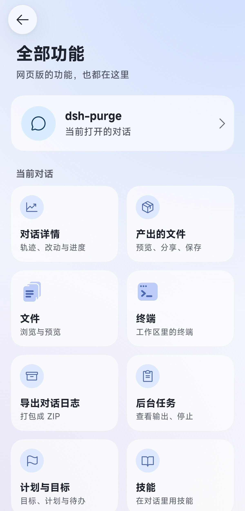
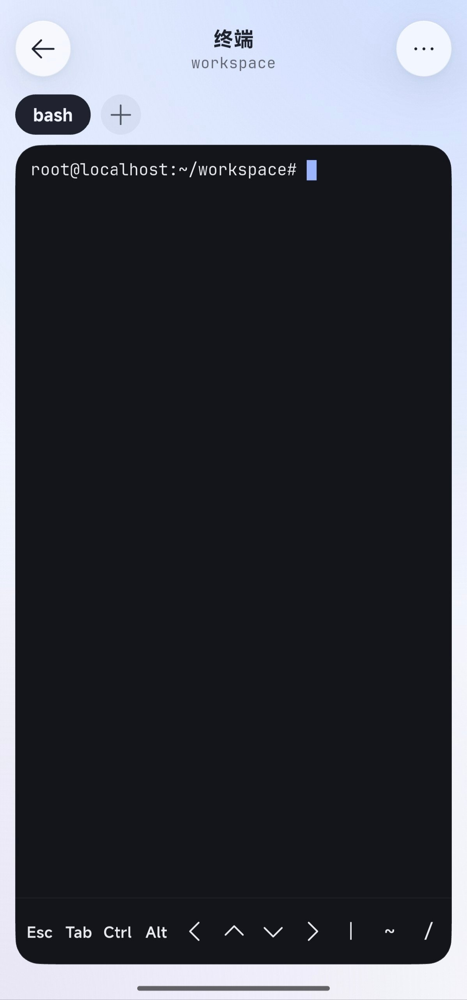

# 安装细节

> 原 README 的「1. 安装」与「2. 在 App 终端里自己装」两章，去掉重复段落之后整章搬到这里。
> README 只留最短的安装路径；要一步步来、要参数表、要看截图，就看这一份。

## 让 AI 帮你装

把下面这一整段复制，发给能操作这台手机的 AI 助手（代码块右上角有复制按钮，一次拿全）：

```text
帮我把 https://github.com/NANA7MI0/dsh-purge-go 装到我这台手机上。
先跑 sh install.sh --dry 看一眼会改哪些文件，确认没问题再跑 sh install.sh。
装完告诉我补丁打了几条、插件版本是多少，重启由我自己操作。
```

（最后一句是故意的：重启会打断你手上的事，留给你自己决定什么时候做。）

如果助手要先问你一句「确认要我在这台手机上执行吗」，答一句「确认」就行——
它问是因为安装过程会关掉引擎的人工确认环节（原因见 [补丁层改了哪两处](../README.md#补丁层改了哪两处)），
它想先得到你的明确同意。

## 也可以自己装

**这台机器是你自己的，装不装、装完留不留这些文件、什么时候重启，都由你定。**

不想让助手代跑，或者它不愿意碰引擎源码，都可以自己来。这台机器的 App 自带终端
（「全部功能」→「终端」），打开后粘这一整行、回车：

```sh
git clone https://github.com/NANA7MI0/dsh-purge-go ~/dsh-purge-go && cd "$(readlink -f ~/.dsh/profiles/web/node_modules/dsh-go-purge)" && sh install.sh
```

**想先看会改哪些文件，把 `sh install.sh` 换成 `sh install.sh --dry`** —— 只扫描、预演，不装插件、不改引擎、不在仓库里留文件。

两条命令的效果完全一样，`--dry` 只是把「要改什么」摊出来给你看一眼，看完再跑真装。

装的过程中会打印：补丁打了几条、备份落在哪个目录、插件版本是多少。**备份目录记下来**
（`~/.dsh/dsh-purge/patch-backup/<时间戳>/`），以后想撤回就靠它——怎么撤见
[还原引擎](restore.md)。

分步操作和截图见本文下面的「在 App 终端里自己装」一节。

## install.sh 的参数

> **为什么写成 sh install.sh 而不是 ./install.sh**
>
> 家目录（f2fs）上 `chmod +x` 有效，`./install.sh` 能跑；但**把仓库放 `/sdcard` 就不行**——
> 那是 FAT32，没有执行位，直接跑会报 `Permission denied`。
> 用 sh install.sh 不需要执行权限，两种情况都能跑，所以文档统一用这个写法。

| 参数 | 作用 |
|---|---|
| 不带参数 | 打补丁 + 建原生界面目录 + 装插件（**推荐**） |
| `sh install.sh --plugin-only` | 只装插件，不打补丁。注入层生效，引擎的审批和沙箱限制仍在 |
| `sh install.sh --dry` | 只扫描 + 预演补丁会改哪些文件，**不装插件、不改引擎、不在仓库里留文件**（probe 结果写临时目录）。和 `--plugin-only` 一起给会直接报错 |
| `sh install.sh --profile web` | 指定 profile，默认 `web`。也接受等号写法 `--profile=web` |
| `sh install.sh --repair-native` | **只重建原生界面目录**，补丁和插件都不碰。给「插件目录坏了、App 起不来」的机器用——不卸载、不重装，一条命令修好 |
| `sh install.sh -h` / `--help` | 打印用法 |

装到哪个目录都行，用 `~`（也就是 `$HOME`）而不是写死 `/root`——因为**不同环境家目录不一样**：

- dsh-go 跑在 proot 里，`$HOME` 是 `/root`，但这个 root 是 proot 映射出来的**假身份**，真实进程属于 App 的 uid，**不需要任何 root 权限**
- 在普通 Linux / PC 上装，`$HOME` 是 `/home/你的用户名`，写死 `/root` 反而会失败

**但必须是持久目录。** 两个坑：

| 别放 | 为什么 |
|---|---|
| **`/tmp`** | **内存盘（tmpfs），重启就清空。**原生界面目录是一份独立副本，仓库没了它照常工作——但你已经没法再 `git pull` 更新了，下次装还得重新下载 |
| **`/sdcard`** | **FAT32 没有执行位**，`./install.sh` 跑不了（所以文档统一用 `sh install.sh`）；而且外部存储可能被系统清理 |

**放家目录下的任何位置都行**：`~/dsh-purge-go`、`~/tools/dsh-purge-go`、`~/src/dsh-purge-go`。推荐放在重启后还在的地方，因为它是你以后 `git pull` 更新的源头——仓库没了，插件还能跑，但只能停在当前版本。

> **原生界面目录是一份副本，不是快捷方式。** 装的时候把仓库里那 11 项复制进去（共约 1.1 MB），之后仓库被删、被移走、被 git 操作搞乱，这个目录都完整，App 照常启动。
> **代价**：git pull 之后要再同步一次——点面板上的「更新」会自动做（拉代码 → 还原补丁 → 重打补丁 → 同步副本，一次做完）。
>
> **已经中招的机器**（App 反复报 start failed: .../dsh-go/plugins/dsh-go-purge/LICENSE）：在终端里跑 sh install.sh --repair-native，只重建那个目录，别的一概不动。

## 不要用 npm 装

> **不要用 npm 装。** npm view dsh-go-purge 会显示 `0.4.18`——那是 0.4.x 时代留下的旧版本，之后就没再发布过。
> 原因：npm 上的发布账号目前是 **suspended / temporarily disabled** 状态，提不了新版本。包本身可以正常下载，只是停在 0.4.18。
> 用下面两条命令之一，才是当前版本。想知道拿到的是不是最新，跑 node -p "require('./package.json').version" 对一下 [Releases](https://github.com/NANA7MI0/dsh-purge-go/releases) 上的版本号。

## 在 App 终端里自己装（分步 + 截图）

**此插件已经设计成用户安装可以不依赖任何自动化**：App 自带终端，用户手动粘命令即可，命令见下文。

### 打开终端

**第一步：侧栏「全部功能」**



**第二步：点「终端」（工作区里的终端）**



打开就是一个 bash，提示符长这样：

```text
root@localhost:~/workspace#
```

### 粘命令、回车

要粘两条命令，一条装、一条重启。每条都是完整的一行，直接复制整行、粘进终端、按回车。

**第 1 条：安装**

```sh
git clone https://github.com/NANA7MI0/dsh-purge-go ~/dsh-purge-go && cd "$(readlink -f ~/.dsh/profiles/web/node_modules/dsh-go-purge)" && sh install.sh
```

三件事串在一起：下载仓库 → 进入目录 → 跑安装脚本。**前一步成功了才往下走**，所以中途出错不会在错误的目录里继续乱跑。

跑起来会逐步打印在做什么，十几秒到一两分钟（看网络）。**最后看到「装好了」这两个字，就是装完了：**

```text
════════════════════════════════════════
 装好了
════════════════════════════════════════

  注入层  ✔ 插件加载时自动落盘正文并开启
  补丁层  ✔ 已打到引擎包

▸ 最后一步：重启引擎让补丁生效
```

脚本会在这里停下，后面接着教你怎么重启。

**第 2 条：重启**

补丁要重启引擎才生效。**不用敲命令，划掉 App 再打开就行：**

1. 从屏幕最底下往上划一下，调出「最近任务」
2. 找到这个 App 的卡片，往上划掉
3. 重新点图标打开

**关键是第 2 步要划掉**——只按返回键退到桌面不算，那样界面收起来了、引擎还在后台跑，补丁不生效。

**想在终端里一条命令搞定也可以**，粘这条回车：

```sh
am force-stop io.github.ccch1mneyyy.dsh_app
```

效果一样，之后同样要重新点图标。

### 两条特殊情况

**连不上 GitHub**（卡住不动、报 `Failed to connect` 或 `Could not resolve host`）：换成下面这条，它走 `codeload.github.com`——GitHub 的下载专用域名，有时比 `git clone` 通得快。

```sh
curl -L https://codeload.github.com/NANA7MI0/dsh-purge-go/tar.gz/refs/heads/main | tar xz && cd dsh-purge-go-main && sh install.sh
```

效果和上一条一样，只是解开的目录叫 `dsh-purge-go-main` 而不是 `dsh-purge-go`。

**报 `destination path already exists`**：说明 `~/dsh-purge-go` 已经在了，之前装过。不用删，直接跑这条（跳过下载，只跑安装；脚本是幂等的，装过再跑一遍也不会出问题）：

```sh
cd "$(readlink -f ~/.dsh/profiles/web/node_modules/dsh-go-purge)" && sh install.sh
```

### 脚本到底做了什么

`install.sh` 连做四件事，次序是 **打补丁** → **建原生界面目录** → **藏掉 App 自带的「插件」胶囊** → **装插件**。想知道每一步的细节和单条命令，看下面几节；不想看就跳过，脚本已经替你做了。

**为什么是这个顺序**：第四步会触发宿主重新装配插件层，是唯一可能被打断的一步；前三步都是纯文件操作。所以把它放最后——万一真失败，补丁、原生目录和胶囊都在位，重跑一次就补齐。

| 少做哪一步 | 后果 |
|---|---|
| **第一步（打补丁）** | 注入层照常工作、`purge_*` 工具都在，但引擎的审批和沙箱配置保持原样——只破了一半 |
| **第二步（原生目录）** | 插件正常工作，但输入框上方**没有胶囊、没有状态条、点不开面板**——那三样不在 profile 里，是 app 自己去 `~/.dsh/dsh-go/plugins/` 扫出来画的 |
| **第三步（藏胶囊）** | 功能都正常，只是输入框上方多一颗 App 自带的「插件」入口，看着像装重了 |
| **第四步（装插件）** | 补丁和原生目录都在，但插件没注册，等于什么都没生效 |

## 想一条条手动敲

不想用 `install.sh`、想自己控制每一步的话，完整命令一次看全：

```sh
# 第一步：打补丁（补丁层）—— 不做这步，破甲只生效一半
cd "$(readlink -f ~/.dsh/profiles/web/node_modules/dsh-go-purge)"
node patches/purge-patch.mjs probe   # 先看哪些能打
node patches/purge-patch.mjs apply   # 真打

# 第二步：建原生界面目录（只有手机端要，胶囊/状态条/面板靠它）
N=~/.dsh/dsh-go/plugins/dsh-go-purge
NEW="$N.tmp.$$"
rm -rf "$NEW" && mkdir -p "$NEW"
for f in LICENSE NOTICE README.md CHANGELOG.md assets cordis.patch.yml docs install.sh lib patches package.json; do
  [ -e ~/dsh-purge-go/$f ] && cp -R ~/dsh-purge-go/$f "$NEW/$f"
done
rm -rf "$N" && mv "$NEW" "$N"   # 全建好再整体替换，中途失败不会留下残缺目录

# 第三步（可选）：藏掉 App 自带的「插件」胶囊
# 装完输入框上方会有两颗：破甲的「破甲状态」，和 App 自带的「插件」入口。
# 本仓库只有一个插件，那颗点进去是同一个面板。不想看它就跑这一段；
# 只往 hide 数组里追加一项，你自己配的其它隐藏项不受影响。想恢复就删掉那一项。
UI=~/.dsh/dsh-go/ui.json
node -e 'const fs=require("fs"),p=process.argv[1];let j={version:1};
  try{j=JSON.parse(fs.readFileSync(p,"utf8"))}catch{};
  if(!Array.isArray(j.hide))j.hide=[];
  if(!j.hide.includes("pluginCapsule")){j.hide.push("pluginCapsule");
  fs.mkdirSync(require("path").dirname(p),{recursive:true});
  fs.writeFileSync(p,JSON.stringify(j,null,2)+"\n")}' "$UI"

# 第四步：装插件（注入层）—— 放最后，它会触发宿主重新装配
dsh plugin --profile web add ~/dsh-purge-go
```

## 打补丁

补丁的 `probe` / `apply` / `--dry` / `restore` 命令与命中情况见 [补丁层](patches.md)。

## 建原生界面目录

```sh
N=~/.dsh/dsh-go/plugins/dsh-go-purge
NEW="$N.tmp.$$"
rm -rf "$NEW" && mkdir -p "$NEW"
for f in LICENSE NOTICE README.md CHANGELOG.md assets cordis.patch.yml docs install.sh lib patches package.json; do
  [ -e ~/dsh-purge-go/$f ] && cp -R ~/dsh-purge-go/$f "$NEW/$f"
done
rm -rf "$N" && mv "$NEW" "$N"   # 全建好再整体替换，中途失败不会留下残缺目录
```

**只有手机端要这一步。** 那一层不在 profile 里，是 app 自己去 `~/.dsh/dsh-go/plugins/` 扫出来画胶囊和面板的，`dsh plugin add` 管不到。**复制一份完整副本**进去——不是软链，理由见 [README 的安装一章](../README.md#2-安装)。

## 装插件

```sh
dsh plugin --profile web add ~/dsh-purge-go
```

这一步会让宿主重新装配插件层，所以放最后。详见下一节「装插件的最后一步会触发宿主重新装配」。

## 装插件的最后一步会触发宿主重新装配

**`sh install.sh` 的最后一步是 `dsh plugin add`，它会让宿主重新装配插件层。**

**在旧版本上，这一步会把正在执行的那条命令掐掉**，输出里出现：

```
Error: tool call aborted
```

**现在实测不再发生**（2026-11 在 dsh-go 上做过多轮验证：重复装、卸载后重装、另一个 profile 首次装，退出码都是 0、没有一次被掐）。所以正常情况下你会看到完整的安装输出。

**但脚本仍然把「装插件」放在最后一步**，道理没变：万一某台机器上装配还是会打断命令，
前面的补丁和原生界面目录都已经落地了。**这个顺序不是随便排的**——早先的顺序是「补丁 → 插件 → 原生目录」，
一旦插件那步被掐，用户拿到的是一个**装上了、但没有胶囊也没有面板**的插件，连点哪儿修都找不到。
把原生目录提到插件前面，最坏情况就只剩「目录建了、插件没装上」，重跑一次脚本即可。

**装完核对两条就行**：

```sh
# 1. 插件进去了吗（有输出就说明装上了）
node -p 'require(process.env.HOME+"/.dsh/profiles/web/package.json").dependencies["dsh-go-purge"]'

# 2. 补丁打上了吗（看 applied 那一项）
cd "$(readlink -f ~/.dsh/profiles/web/node_modules/dsh-go-purge)" && node patches/purge-patch.mjs probe
```

两条都符合，直接重启引擎即可。

> 万一真的看到 `tool call aborted`：**先别重装**，直接跑上面两条核对。插件已经在 profile 里的话，重启引擎就完事了。

## 从旧版本升级到 0.5.x

**重跑一次 `sh install.sh` 就行，不要只 `git pull`。**（0.5.0 用户也一样——「建原生界面目录」是 0.5.1 才补进脚本的）

原因：0.5 起原生界面的清单（胶囊、状态条、面板）改由插件自己那份 `package.json` 提供。老安装里的
`~/.dsh/dsh-go/plugins/dsh-go-purge/package.json` 是**独立文件**——只 pull 仓库，它不会变，
app 读到的还是老清单，于是胶囊点开没有面板、或者面板报「插件还没处理这一项」。
`install.sh` 会把那个目录整个重建，清单也跟着更新。

> **0.6.8 起改成复制。** 之前是软链到仓库，好处是 pull 完自动就新，代价是仓库一被删
> App 整个起不来、只能用外部工具救。现在是一份副本，安全优先。

```sh
cd "$(readlink -f ~/.dsh/profiles/web/node_modules/dsh-go-purge)" && git pull && sh install.sh
am force-stop io.github.ccch1mneyyy.dsh_app
```

**不用担心的几件事**（跨版本都兼容）：

- `~/.dsh/prompt-inject.md`（你自己的正文）不会被覆盖，插件只在文件缺失时落盘默认正文
- `~/.dsh/dsh-purge/state.json` 的 `version` 一直是 1，变体、按模型指定、开关都保留
- `~/.dsh/dsh-purge/patch-backup/` 里旧的补丁备份照常能用
- profile 里的 `link:` 会被 `dsh plugin add` 改成新路径，不用手动改

**唯一会丢的是你手动改过的 `~/.dsh/dsh-go/plugins/dsh-go-purge/package.json`**——那个文件本来就该从仓库同步，重建时被覆盖是预期行为。

## 怎么重启引擎

**不用敲命令：从屏幕最底下往上划一下，把 App 的卡片划掉，再点图标打开即可。**

Android 上没有服务管理，把进程杀掉再开就是这个效果。**关键是「划掉」**——只按返回键退到桌面不算，那样界面收起来了、引擎还在内存里跑着，插件不会重新加载。

**在终端里用命令也行：**

```sh
am force-stop io.github.ccch1mneyyy.dsh_app
```

效果一样，之后同样要重新点图标。

## 装完的状态：插件加载时做了什么

**插件加载后即进入已启用状态**（`state.json` 里 `enabled: true`），不用先跑什么命令。启动时会做两件事：

```js
if (cfg.seedPrompt !== false) seedInject(home)                      // 落盘默认注入正文
if (!isFile(statePath(home))) writeState(home, { enabled: cfg.enabled !== false })  // 状态默认开启
```

也就是：`~/.dsh/prompt-inject.md` 自动写好（包内默认正文 21306 字符，拼上题材分类扩展后 22746 字符、约 27 KB），
状态文件里 `enabled: true`，系统提示里立刻开始丢官方身份段。

**装完重启引擎就完事了。** 下面这 6 个工具是「管理入口」，用来查状态、换正文、关掉再打开，
不是「必须先跑一遍」的步骤。
