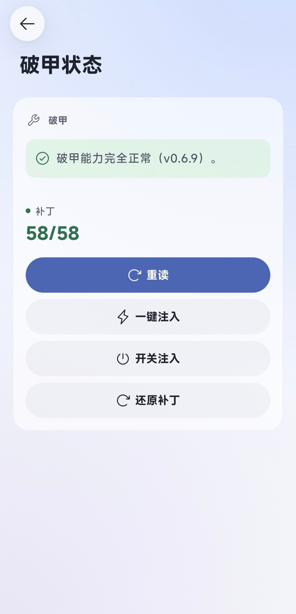

# 操作工具、`/purge` 命令与面板

> 原 README 的「5. 6 个操作工具」整章，加上「5.1 面板长什么样」「5.2 不走界面的时候」和「1.3 不用手动准备注入正文」。
> README 只留一张速查表，参数细节都在这里。

## 六个工具

装好之后，对话里会多出六个工具：

| 工具 | 干什么 |
|---|---|
| `purge_status` | **看两层状态**：注入层（开关、正文来源与体积、当前变体、按模型指定、上次组装压掉哪些官方段）+ 补丁层（引擎路径、手机适用多少条、已生效多少条、按用途的分布）——和面板同一套口径，面板给结论、工具卡给明细 |
| `purge_apply` | 重新开启破甲并确保正文存在。**装的时候已经自动做过一次**，只在关掉之后想重开、或正文丢了想补回来时用。`force=true` 覆盖重写 |
| `purge_revert` | 关闭破甲，把当前正文备份到 `dsh-purge/backups/`（正文本身保留） |
| `purge_prompt` | 读写注入正文与变体。`show` / `set` / `reset` / `use` / `default` / `map`（按模型指定变体） |
| `purge_category` | 题材分类扩展层。`list` / `add` / `rm` / `on` / `off` / `reset` / `bake` |
| `purge_patch_apply` | **打补丁层**。`apply`（打）/ `restore`（还原）/ `probe`（只看）。走子进程执行、带 120 秒超时，比面板按钮更稳，适合让 AI 代劳 |

除了工具，还注册了一个斜杠命令 `/purge`，可以直接在输入框敲——**手上没有 AI 时用它最方便**：

| 命令 | 干什么 |
|---|---|
| `/purge status` | 现状（开关、来源、体积、变体） |
| `/purge on` / `/purge off` | 开关注入 |
| `/purge apply [force]` | 开启并确保正文存在 |
| `/purge revert` | 关闭并把正文备份到 `dsh-purge/backups/` |
| `/purge seed [force]` | 重写包内默认正文到 `prompt-inject.md` |
| `/purge prompt show` | 看正文前 1200 字 |
| `/purge prompt set <文件>` | 用文件的全文替换正文（比如 `/purge prompt set /sdcard/x.md`） |
| `/purge prompt reset` | 恢复包内默认正文 |
| `/purge variant list` / `use <名字>` / `default` / `map <模型> <名字\|->` | 变体管理，`map` 里写 `-` 表示取消该模型的指定 |
| `/purge cat list` / `show <id>` / `on\|off <id>` / `rm <id>` / `reset` / `bake` | 题材分类扩展层 |
| `/purge cat add <id> <别名,别名> <规则正文> [\| 路由]` | 加一条分类。**参数一个都不能少**，少了会直接报用法错 |
| `/purge home` | 打印相关路径 |

记不住就敲 `/purge help`，它会把这张表完整打出来。（只敲 `/purge` 等于 `/purge status`，看的是当前状态。）

**前五个管注入层，`purge_patch_apply` 管补丁层。** 补丁同样可以在命令行打
（`node patches/purge-patch.mjs apply`，见 [补丁层](patches.md)），两条路等价。

## 面板长什么样

点输入框上方的「破甲状态」胶囊，直接打开的就是这一屏（从上到下三块：一句话总结、补丁数字、一排按钮；有新版可装时，数字下面还会多一条更新提示）。

**面板挂在三个地方**（同一份内容，从哪进都行）：对话页签、聊天侧栏、App 的功能页。最常用的入口是胶囊。



<sub>↑ 正常工作时的样子。面板只回答三个问题：破甲在不在工作、补丁打没打上、四个按钮能不能点。</sub>

面板里从上到下是这些（按钮见下面那张表）：

| 块 | 显示什么 |
|---|---|
| **一句总结** | 一句话概括两层状态，底色会变：**正常是绿底**（「破甲能力完全正常（v0.7.1）。」，括号里是当前插件版本）、有补丁没打上变黄、注入关了或补丁层被打穿变红 |
| **补丁** | 一个数字，比如 `59/59`。分母是**这台机器上真会被改动的补丁条数**——不是全部 87 条（26 条要改的包手机上没有），也不算 #2/#3 这两条「反向补丁」（它们的判据就是官方原版文案，不改任何文件）。分子只算真正打完的。**大面积为未打时显示「未打」**，不显示 `2/58` 那种容易误读的数。要看逐条明细：`node patches/purge-patch.mjs probe` |

**四个按钮**（上限就是四个）：

| 按钮 | 干什么 | 什么时候点 |
|---|---|---|
| **重读** | 重新扫一遍引擎刷新补丁数字，同时重新问一次远端有没有新版本 | 手动改过文件、想确认刚才那步生效没有、或者刚更新完想知道还有没有下一个版本 |
| **一键注入** | 先把注入打开、再顺手把补丁打上（补丁在下一拍执行，不卡界面） | **最常用**：装完、App 更新后、或者关过破甲想重新开 |
| **开关注入** | 只切注入层，不动补丁 | 想临时关掉注入、但保留补丁 |
| **还原补丁** | 从最近的备份还原被改过的引擎文件 | 想让引擎回到原版（注意：**不重装引擎包，只还原文件**） |

> 面板每 30 秒自己刷新一次数据（`REFRESH_MS = 30_000`），点「重读」可以立刻刷。
>
> **别把面板和状态条搞混**：
> - **面板**（点胶囊打开的那一屏）一直能开，你主动去看它。
> - **状态条**（输入框上方那条横条，`tone: warn`）**只在出问题时自己出现**，正常时完全不显示。它按情况从三句话里挑一句，都很短（都在 12 字内）：
>   `破甲未工作 · 点开修复`（两层都停）/ `破甲已关 · 点开恢复`（只关了注入）/ `破甲异常 · 点开处理`（补丁被冲掉）
>
> 两者读同一份数据，数字永远一致。点状态条也是进同一个面板。

**至于面板背后那堆端点**：每个都只是包一层工具调用，没有面板照样能让 AI 直接调，拿到的数据一样，只是多花点 token。

> 红队插件自带的右侧控制台同理：装好之后在 dsh-go 里看不到，但它的 10 个页签（资产测绘、
> 攻击链、漏洞战果、报告等）都只是 `redteam_*` 工具的可视化封装——没有面板，数据照样能查。

## 不走界面的时候

面板能做的事，命令行也都能做——不需要插件、不需要 AI、不需要打开 App：

```sh
node patches/purge-patch.mjs probe      # 看状态：哪些能打、哪些已经打了
node patches/purge-patch.mjs apply      # 打补丁
node patches/purge-patch.mjs restore    # 还原补丁
```

注入层的开关用斜杠命令：`/purge on` / `/purge off`，看状态用 `/purge status`（完整列表见上一节）。

## 注入正文：不用手动准备

插件首次加载时会把默认正文落盘到 `~/.dsh/prompt-inject.md` 并默认开启（包内正文 21306 字符；
拼上题材分类扩展层后 26.2 KB）；**文件已存在时只在缺失才写入，不会覆盖你现有的正文**。
想换成自己写的，装好之后用 `purge_prompt` 的 `set` 或直接编辑那个文件都行。

### 仓库里那份正文为什么是密文，怎么自己看

`lib/asset-table.json` 里存的是加密后的正文。**它不是被藏起来了——密钥就在同一个仓库里**：

- 派生密钥用的固定盐在 `lib/table-key.js` 的 `MIX` 常量里
- 每次加密随机生成的 `MASK`、`TAG`、`IV` 和密文 `SLOT` 一起存在 `lib/asset-table.json`
- 解开只要一条命令，在仓库目录下跑：

```sh
sh scripts/dump-prompt.sh
```

**会原样打印出全部 21306 字符**，就是装完之后写进 `~/.dsh/prompt-inject.md` 的那一份。
不想用脚本的话，等价的一行：

```sh
node --input-type=module -e "import('./lib/table-read.js').then(m => console.log(m.openSlot()))"
```

**那为什么还要封这一层？** 正文里有大量命令行风格的长句，明文平铺在公开仓库里，
整个仓库容易被平台的文本扫描器整库标记——**这跟正文具体写了什么无关，是扫描器的粗粒度判断**。
被标之后，别人来 clone 会被拦、issue 也发不出来。封一层之后普通 `grep` 搜不到这些长句，仓库能正常用。

**所以它不是保密设施，也防不住任何人**：密钥和密文放在一起，上面那条命令就能解开。
它只做一件事——别让整个仓库被误判。

**装完之后更简单**：正文已经明明白白写在 `~/.dsh/prompt-inject.md` 里，`cat` 一下就能看，也能直接改。
